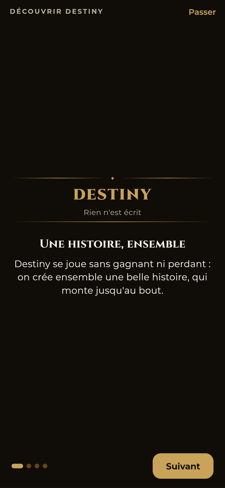
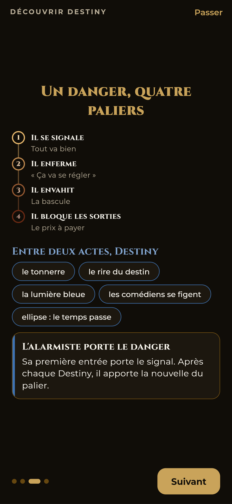
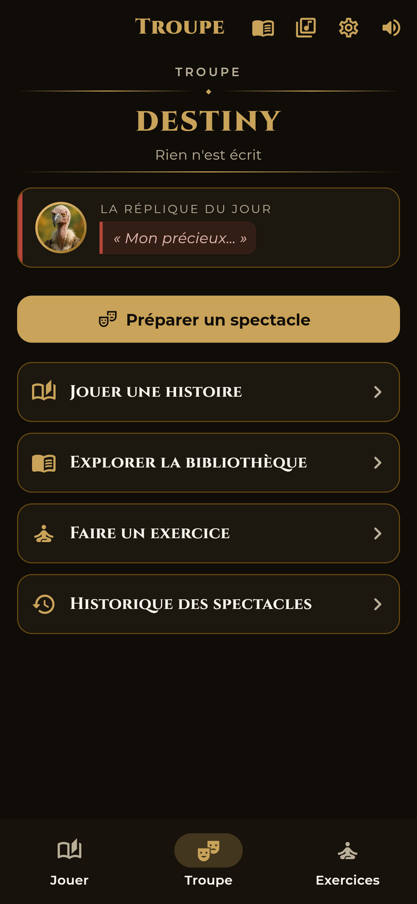
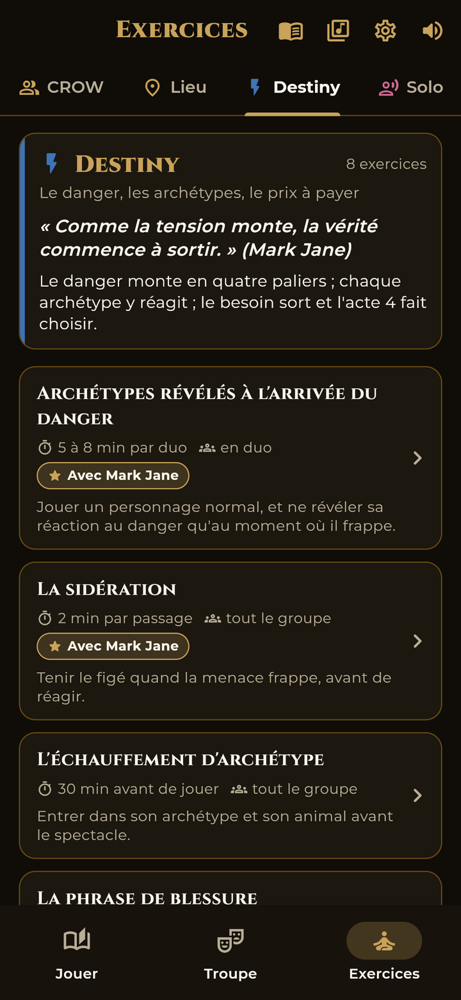
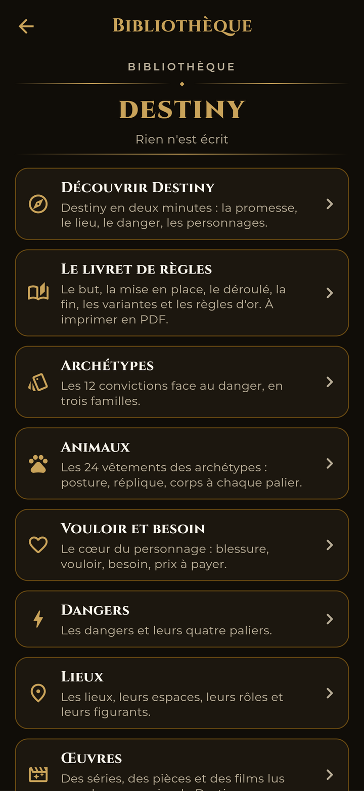

# DestinyStory — Les fonctionnalités

> Application Flutter (Android, iOS, web) pour l'**improvisation dramatique**, avec la grammaire de Destiny.
> Tout fonctionne **hors ligne**, à partir des fichiers de l'appli et d'une base locale. Seuls les modes « avec l'IA » demandent une clé d'API.
>
> Version documentée : **2.0.0** — voir le [CHANGELOG](../CHANGELOG.md).

## Aperçu

| Découvrir Destiny | Le danger et le rituel | Troupe |
|:---:|:---:|:---:|
|  |  |  |
| **Exercices : Destiny** | **Bibliothèque** | |
|  |  | |

> *Captures de la version web 2.0.0, en thème sombre.*

---

## 1. Vue d'ensemble

**La promesse : rien n'est écrit.** Un lieu, un groupe qui se connaît, un danger qui monte en quatre paliers, et Destiny entre les actes. Chaque personnage a un **archétype** (sa conviction face au danger), un **animal** (son corps), une **blessure**, un **vouloir** et un **besoin**. À l'acte 4, il paie le prix : il choisit entre son vouloir et son besoin.

Trois onglets en bas de l'écran :

| Onglet | Pour quoi faire |
|---|---|
| **Jouer** | Le jeu de rôle entre humains (épisode, saison, série), ou une partie avec l'IA. |
| **Troupe** | Préparer, jouer et débriefer un spectacle ou une répétition. L'appli s'ouvre ici. |
| **Exercices** | Des échauffements et des jeux de théâtre, chronométrés. |

En haut à droite : la **Bibliothèque**, la **Musique**, les **Réglages** et le **son**.

**Le design** suit la direction artistique de la grammaire : la nuit et l'or, Cinzel pour les titres, Montserrat pour le texte. Trois couleurs pour les trois familles (vert : elles tiennent le groupe ; bleu : elles interprètent le danger ; rouge : elles fissurent le groupe), le bleu Destiny pour le rituel, et le sigle jaune **KIDS** sur tout ce qui se joue avec des enfants. Thème **sombre**, **clair**, ou celui du téléphone.

---

## 2. Découvrir Destiny

Au premier lancement, quatre écrans pour comprendre le format en deux minutes, tous tirés de la grammaire :
1. la promesse ;
2. le lieu et le groupe ;
3. le danger en quatre paliers, et le rituel Destiny ;
4. les personnages : les trois familles, le vouloir et le besoin.

On peut les passer, et les revoir depuis la Bibliothèque ou les Réglages.

---

## 3. Troupe : le spectacle

L'accueil montre la promesse et, un jour sur deux, la règle d'or ou la réplique du jour. Puis :

1. **Préparer** : spectacle ou répétition, avec ou sans enfants, 4, 5 ou 6 joueurs et leurs prénoms.
   - La distribution se fait par choix concerté, tirage équilibré ou exemple tout prêt.
   - L'alarmiste est toujours là, et chaque famille est représentée. Une distribution déséquilibrée est refusée, avec une phrase qui dit pourquoi et une correction en un geste.
   - Chaque joueur choisit son animal parmi les deux de son archétype.
2. **L'échauffement** : la carte de chaque joueur, les trois questions (« Comment je me tiens ? »…), la limite (« le corps, pas l'histoire ») et un minuteur.
3. **Avant d'entrer en scène** : les règles d'or, les quatre paliers et la phrase des débriefs. Aucune critique.
4. **La mise en place** : trois lieux et trois dangers à voter à main levée (ou un choix libre), le groupe, deux liens pour commencer, les trois objets, le mystère et sa réponse, le chrono (20, 30 ou 45 min). Avec l'IA, l'appli peut proposer les objets et le mystère.
5. **La régie** :
   - un gros chrono et l'acte en cours ;
   - le **bouton Destiny**, réservé à la régie. Il se déclenche aussi tout seul aux minutes prévues, selon le réglage ;
   - le rituel en plein écran : le tonnerre, le rire du destin, la lumière bleue, le figé, l'ellipse ; puis la nouvelle de l'alarmiste ;
   - au premier figé, le rappel de fixer le besoin ;
   - à chaque acte, le geste (Dire, Bloquer, Nommer, Choisir) ; pour chaque joueur, ce que fait son archétype et le corps de son animal à ce palier ;
   - à l'acte 4, le dilemme du danger ;
   - les moments forts notés avec l'heure, et la régie son.
6. **Le débrief**, pour chaque personnage : « il veut… mais il a besoin de… », face à la phrase fixée au premier figé ; le choix de l'acte 4 et le prix payé ; ce qui a marché. Avec l'IA, un coach peut proposer ses phrases (les prénoms ne partent pas).
7. **L'historique** des spectacles et des répétitions, chacun exportable en **PDF**.

---

## 4. Jouer entre humains : la Série

- **L'épisode** : un lieu, un groupe, un danger en quatre paliers, quatre actes. Il se suffit à lui-même. **« Faire la suite »** en fait le premier épisode d'une saison.
- **La saison** : quatre épisodes et un **méchant** qui agit dans l'ombre. Chaque danger est l'un de ses coups ; on voit d'abord ses **deux sbires** ; il n'apparaît qu'à l'épisode 4, et on le vainc par sa **faille**. Le besoin du personnage appartient à la saison : fixé à l'épisode 1, nommé à l'épisode 3, payé au final.
- **La série** enchaîne les saisons. Entre deux saisons, un personnage qui a payé son besoin peut changer d'archétype.
- **21 univers** (12 pour adultes, 10 pour enfants, Super-héros est des deux) avec leurs lores, leurs peuples, leurs lieux, leurs **figurants** (trois par lieu), leurs **dangers** (trois par univers) et leurs **méchants**.
- **Les figurants et les sbires** : deux modes distincts. Un figurant peut basculer en sbire, et c'est noté au registre.
- **Le registre** garde les figurants, les sbires, les objets, les lieux, les secrets, les promesses, les morts (adultes seulement), le traître et ce que le méchant a laissé. Au début d'un épisode, l'IA peut proposer deux ou trois éléments à ressortir. Il ne contient **jamais les prénoms des joueurs**, seulement les personnages. Il s'exporte en PDF.
- **Le traître** : une option, désactivée par défaut. En saison, c'est le méchant qui le recrute, en secret.
- **Le combat** et **la pièce du destin** restent, en option.
- **La transcription** (facultative) : le téléphone écrit la scène localement pour aider au résumé ; aucun son n'est gardé, et l'on voit ce qui part avant tout envoi à l'IA.

### Le mode kids

- Seuls les éléments marqués **KIDS** sont proposés : lieux, dangers, méchants, sbires.
- Chaque enfant choisit **un pouvoir**, gardé toute la saison. Il aide, il ne résout jamais tout seul.
- **Personne ne meurt** : au palier 4, on renonce à quelque chose, ou on se sépare un moment.
- Le parent tient le destin : il lance le danger, fait les présages, joue les sbires et les figurants.

---

## 5. Jouer avec l'IA

Facultatif : il faut une clé d'API (Anthropic ou OpenAI), à régler dans **Réglages › IA**. Les prompts sont réunis dans `lib/application/prompts/`, versionnés et testés ; chacun contient la grammaire en version courte, générée depuis le fichier.

- **L'histoire avec l'IA** : on choisit son archétype, son animal, et si on veut une blessure et un vouloir. L'IA joue les autres, avec une distribution équilibrée. Quatre chapitres, un par palier ; **Destiny tombe entre deux chapitres**. La **pièce du destin** tranche chaque action. Au dernier chapitre, on choisit : le vouloir ou le besoin. Le résumé suit le coach de débrief.
- **Le spectacle avec l'IA** : quatre personnages tirés en distribution équilibrée, quatre actes, Destiny avec un bouton, et un **débrief positif** : l'histoire, ton personnage, la phrase clé, ce qui a marché, une piste pour la prochaine fois.
- Les univers viennent de `univers.json`. Chaque mode a sa version **enfant** : des frissons doux, jamais d'effroi.
- Modèles Claude proposés : Opus 5.5 (par défaut), Sonnet 5.5, Haiku 5.5, Fable 5.1, et les précédents.

---

## 6. Exercices

- **Les thèmes du carnet** : Échauffement, Statut, Spontanéité, Écoute, Dialogue, Imagination, avec **le principe du jour**.
- **Les 20 exercices de la grammaire**, en trois thèmes, chacun ouvert par son principe :
  - **CROW** (qui, avec qui, pour quoi, où) ;
  - **Lieu** (un seul lieu, bien installé) ;
  - **Destiny** (le danger, les archétypes, le prix à payer).

  Chaque fiche donne le but, les consignes, des exemples, la question du débrief, la variante et la source, avec le badge **« Avec Mark Jane »**. Elle propose un chrono réglé sur la durée conseillée, des **cartes à tirer** au hasard, et un lien vers la notion dans la Bibliothèque.
- **Solo** : 50 virelangues, avec un tirage au hasard.
- Chaque exercice se joue au **chrono**, avec une célébration à la fin. Sans score.

---

## 7. La Bibliothèque

- **Découvrir Destiny** (les quatre écrans du début).
- **Le livret de règles** : le but, le matériel, les rôles, la mise en place, le déroulé, la fin, les variantes (4 à 6 joueurs, Série, méchants, sbires, figurants, registre, traître, mode kids) et les règles d'or. Chaque règle vient de la grammaire. **Export PDF.**
- **Les archétypes** : les 12, rangés en trois familles, avec leur montée palier par palier, leurs deux animaux, leurs modèles dans les œuvres et leurs méchants reflets. **Cartes à imprimer en PDF** : un recto par archétype (12 cartes) ou par animal (24 cartes), un verso Destiny, neuf cartes de 63 × 88 mm par page.
- **Les animaux** : les 24, avec leur port, leur posture, leur statut de départ, leur réplique (et sa version kids) et leur corps à chaque palier.
- **Vouloir et besoin** : les six couches du personnage, la phrase clé, le piège (« un besoin n'est jamais un objet »).
- **Les dangers** et **les lieux**, avec leurs paliers, leurs espaces, leurs rôles et leurs figurants.
- **Les œuvres** : des séries, des pièces et des films lus avec la grammaire.
- **Les méchants** : les 24 grands méchants et ceux des 21 univers, avec leurs sbires et leurs présages.
- **Les figurants**, **le mode kids**, **les outils de jeu** (les mains occupées, le sous-texte, les silences…) et **le lexique** (ce qu'on dit, et ce qu'on ne dit plus).

---

## 8. Musique et régie son

- **La Musique** : les pistes classées par catégorie (Émotions, Lieux, Ambiances, Thèmes, Univers), avec un lecteur.
- **La régie son** : un mixeur accessible pendant le jeu, avec la lecture en boucle et le volume.
- **Les quatre moments** du spectacle ont leur musique, dans les Réglages : le début, le son de Destiny, l'ambiance de l'acte 2 et la fin. On peut importer ses propres musiques, et en associer une à chaque Destiny.

---

## 9. Réglages

- **Destiny** : les chronos (durée et minute de chaque Destiny, retour aux valeurs par défaut), le déclenchement (automatique, manuel ou les deux), le rituel (lumière bleue, durée du figé, texte de l'ellipse, rappels), les musiques, la distribution par défaut, le jeu de rôle (kids, traître, registre, combat, pièce, évolution d'archétype), l'échauffement, les cartes.
- **IA** : le fournisseur, le modèle et la clé.
- **Apparence** : le thème (sombre, clair, comme le téléphone), les visuels des cartes, la taille et l'écriture manuscrite du texte de l'histoire.
- **Données** : les lieux et les dangers (espaces, rôles, quatre paliers nommés comme dans la grammaire, palier 4 en version kids, sigle KIDS), les détails des lieux, l'antisèche des relations, les **dilemmes de l'acte 4**, et le rapport de synchronisation avec la grammaire.
- **Mode admin** : la vérification de la grammaire et la lecture des archétypes.
- **Aide** : Découvrir Destiny, Me contacter, Crédits (dont les licences des polices), À propos.

---

## 10. Accessibilité

- L'appli suit la **taille de texte du téléphone** ; les écrans principaux sont testés avec des caractères 60 % plus grands, sur un téléphone de 390 px de large.
- Chaque bouton a un **nom lu par les lecteurs d'écran**.
- Les couleurs du texte ont un **contraste d'au moins 4,5** en clair comme en sombre.
- **« Réduire les animations »** calme le rituel (le réglage du téléphone est aussi suivi).
- L'écran reste allumé pendant le jeu.

---

## 11. Confidentialité et données

- **Hors ligne** par défaut. La régie, le rituel et la Série ne dépendent jamais du réseau.
- Seuls les modes IA envoient du texte, avec la clé de l'utilisateur, au fournisseur choisi. Les prénoms des comédiens ne partent pas ; le registre ne garde que des personnages.
- La transcription reste sur l'appareil ; aucun son n'est gardé.
- **Rien n'est perdu à la mise à jour** : les anciennes campagnes deviennent des séries, les anciennes histoires se relisent, les lieux et dangers modifiés sont gardés, une sauvegarde illisible n'est jamais écrasée.
- Politique de confidentialité : [`privacy.html`](privacy.html).

---

## 12. Build et publication

- **Android** : `flutter build appbundle --release` (Google Play) ou `flutter build apk --release`.
- **Web** : `flutter build web --release --base-href /Destiny/app/`, copié dans `docs/app` (GitHub Pages).
- **CI/CD** : [`cicd_setup.md`](cicd_setup.md). **Fiche Play Store** : [`play_store_listing.md`](play_store_listing.md).
